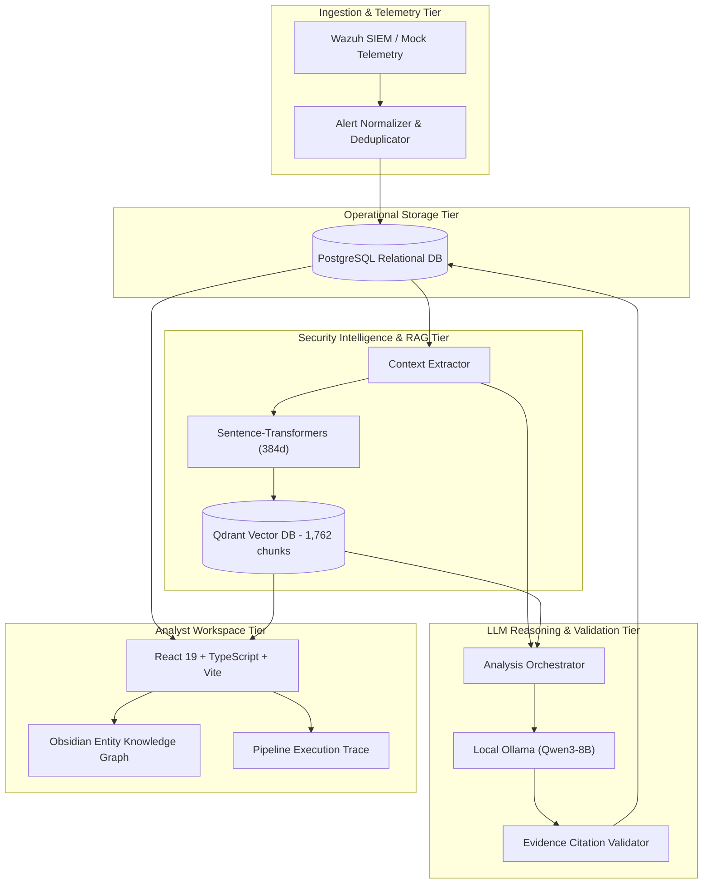

# System Architecture & Technical Specification

**Project**: AI-Powered Security Operations Center (SOC) Assistant Using Large Language Models  
**Architecture Version**: 2.0 (Research Investigation Workspace)  

---

## 1. High-Level Architecture Overview

The system is structured as a decoupled, multi-tier security investigation platform:



---

## 2. Component Boundaries & Responsibilities

### 2.1 Ingestion Tier
- **`app/wazuh/client.py`**:
  - `MockWazuhClient`: Deterministic telemetry generator for testing and offline development. Loads benchmark attack scenarios (brute force, web shells, lateral movement).
  - `RealWazuhClient`: REST API client communicating with Wazuh Manager via token-based JWT authentication (`/security/user/authenticate`).
- **`app/wazuh/service.py`**:
  - Handles synchronization and idempotent deduplication (`external_alert_id` index in PostgreSQL).

### 2.2 Storage Tier
- **PostgreSQL 15+**:
  - `alerts`: Ingested security event telemetry (IPs, users, agents, rule IDs, raw JSON).
  - `analyses`: Persisted LLM investigation records (summary, severity assessment, reasoning, recommended actions, confidence, model).
  - `evidence`: Foreign-key linked citations retrieved from Qdrant associated with a specific analysis run.
  - `alembic/`: Database migration tracking.

### 2.3 Retrieval & Vector Tier
- **`app/security/context.py`**:
  - Analyzes raw alert payloads to extract entities: source/destination IPs, usernames, agent names, triggered rule metadata, and MITRE technique IDs (`T1xxx`).
  - Synthesizes multi-faceted search queries (rule query, technique query, combined context).
- **`app/rag/knowledge/embeddings.py`**:
  - Generates 384-dimensional dense vectors using `sentence-transformers/all-MiniLM-L6-v2`.
- **`app/rag/knowledge/vectorstore.py`**:
  - Interfaces with Qdrant collection `security_knowledge`.
  - Supports hybrid retrieval: cosine dense vector search combined with exact payload filtering (`source_identifier`, `document_id`).

### 2.4 LLM Reasoning & Evidence Grounding Tier
- **`app/services/orchestrator.py`**:
  - Coordinates the three research analysis modes:
    1. `llm_only`: Raw alert passed to LLM without knowledge base context. Baseline for hallucination measurement.
    2. `standard_rag`: Single retrieval query constructed from rule description. Basic vector retrieval without context refinement.
    3. `evidence_aware`: Multi-faceted entity extraction, targeted queries, hybrid retrieval, prompt grounding, and post-generation citation validation.
- **`app/llm/providers/ollama.py`**:
  - Communicates with local Ollama daemon executing `qwen3:8b`.
- **`app/llm/parsers.py` & `app/services/evidence_validator.py`**:
  - Validates that model citations exist within the set of retrieved documents.

---

## 3. Investigation Graph Data Contract

The Obsidian-style security investigation graph endpoint (`GET /api/v1/alerts/{alert_id}/graph`) outputs:

```typescript
interface InvestigationGraphData {
  alert_id: number;
  node_count: number;
  edge_count: number;
  nodes: GraphNode[];
  edges: GraphEdge[];
}

interface GraphNode {
  id: string;
  label: string;
  type: 'alert' | 'host' | 'user' | 'ip' | 'rule' | 'mitre_technique' | 'cve' | 'evidence' | 'claim';
  provenance: 'observed' | 'retrieved' | 'knowledge_base' | 'inferred';
  attributes: Record<string, unknown>;
}

interface GraphEdge {
  id: string;
  source: string;
  target: string;
  relationship: string;
  provenance: 'observed' | 'retrieved' | 'inferred';
  evidence_id?: number;
}
```

---

## 4. Execution Trace Contract

The per-run pipeline execution trace endpoint (`GET /api/v1/alerts/{alert_id}/trace`) outputs:

```typescript
interface ExecutionTraceData {
  alert_id: number;
  analysis_id?: number;
  mode: string;
  total_duration_ms: number;
  stages: TraceStage[];
}

interface TraceStage {
  stage_name: string;
  component: string;
  status: 'completed' | 'in_progress' | 'failed' | 'skipped';
  duration_ms: number;
  records_processed: number;
  details: string;
  error?: string;
}
```

The 10 standard trace stages include:
1. Alert Ingestion & Parsing
2. Security Context Extraction
3. Retrieval Query Formulation
4. Semantic Embedding Generation
5. Qdrant Vector Retrieval
6. Evidence Selection & Grounding
7. LLM Prompt Formulation
8. Local Ollama Inference (Qwen3-8B)
9. Structured Output Parsing & Citation Validation
10. PostgreSQL State Persistence

---

## 5. Security & Safety Principles

1. **Non-Destructive Advisory Recommendations**: All remediation guidance generated by the LLM is explicitly marked advisory. The platform never executes automated network isolation, process termination, or firewall changes.
2. **Provenance Distinction**: Telemetry observed directly from the sensor is rendered with a distinct cyan accent (`observed`), while external knowledge is green (`knowledge_base`) and AI interpretations are purple (`inferred`).
3. **No Fabricated Health or Telemetry**: When external integrations are offline or unverified, the system explicitly reports their true status without fallback deception.
