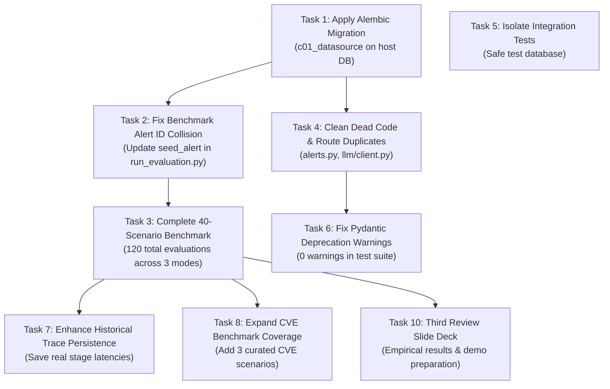

# PPD-II Third Review Implementation Roadmap & Requirement Mapping

**Project:** AI-Powered Security Operations Center (SOC) Assistant Using Large Language Models  
**Review Target:** PPD-II Third Review (Faculty Milestone Evaluation)  
**Audit Date:** 2026-11-09  

---

## 1. Faculty Requirement Mapping Matrix

The department evaluation for PPD-II Third Review mandates demonstration across six explicit categories:

| Faculty Requirement | Existing Implementation | Verified Evidence | Missing Work to Complete | Review Priority |
|---|---|---|---|---|
| **1. Implementation Completion** | FastAPI, PostgreSQL, Qdrant, Ollama, React 19 UI, Obsidian Graph, Waterfall Trace | 258 passing tests, production Vite build, 1,762 indexed Qdrant chunks | Apply Alembic migration `c01_datasource` on host DB; resolve duplicate route definitions; complete live Wazuh connection or test harness | **CRITICAL** |
| **2. Testing** | Comprehensive backend unit tests (226) & frontend tests (32); E2E verification script | Pytest & Vitest reports (100% passing across 258 tests) | Fix destructive SQL in `test_alerts_sync.py`; add automated E2E integration test; update 7 Pydantic deprecation warnings | **HIGH** |
| **3. Results** | Dataset v1 completed (8 cases $\times$ 3 modes = 24 evaluations); Dataset v2 partial (12 cases $\times$ 3 modes = 36 evaluations) | Raw JSON results in `backend/evaluation/results/` | Fix DB collision bug in `seed_alert`; execute remaining 28 cases (84 evaluations) to achieve 100% completion of Dataset v2 | **CRITICAL** |
| **4. Analysis** | Retrieval ablation (anchored vs unanchored vs hashing); latency analysis; tri-mode metric comparisons | `ablation.json`, `results_partial.json`, comparative tables | Detailed failure analysis of false positives; analyze latency bottlenecks (CPU Ollama); generate comparative charts | **HIGH** |
| **5. Innovation** | Entity-Anchored Security Retrieval; Strict Evidence Reference Validation; Force-Directed Provenance Graph | Documented in `INNOVATION_AND_CONTRIBUTIONS.md` | Formalize ablation tables and TikZ workflow diagrams for presentation slides; prepare live demo script | **HIGH** |
| **6. Technical Contribution** | Provenance-grounded local triage pipeline; multi-source telemetry isolation; open reproducible benchmark | Verified code and empirical metrics | Academic report write-up; third review LaTeX Beamer presentation update | **HIGH** |

---

## 2. Categorized Task Inventory

### Priority Tier 1: Critical (Must Complete Before Third Review Demo)

1. **Task 1: Resolve Database Schema Divergence (Apply `c01_datasource` Migration)**
   - *Problem:* Host PostgreSQL is at revision `bdd08d1a3d55`, missing `data_source` and `ingestion_timestamp` columns, which causes 500 errors on `/alerts` and `/dashboard/stats`.
   - *Action:* Execute `alembic upgrade head` on the active host database.
   - *Acceptance Criteria:* `GET /api/v1/alerts` and `GET /api/v1/dashboard/stats` return HTTP 200 with proper `data_source` filtering.

2. **Task 2: Fix Benchmark Database ID Collision Bug in `run_evaluation.py`**
   - *Problem:* `seed_alert()` reuses old alert IDs (`eval-001` through `eval-008`), causing the LLM to evaluate stale Dataset v1 alerts against Dataset v2 ground truth (creating false 0.0 scores).
   - *Action:* Update `seed_alert()` to update the existing alert row or use isolated unique IDs (e.g. `eval-v2-xxx`), or provide a database clean/seed flag.
   - *Acceptance Criteria:* In Dataset v2, cases 3 through 8 receive the actual Kerberoasting, MFA Fatigue, Encoded PowerShell, WScript, and Reverse Shell alert payloads.

3. **Task 3: Complete the 40-Scenario Dataset v2 Benchmark**
   - *Problem:* Only 12 of 40 cases (36 of 120 evaluations) are completed.
   - *Action:* Run `python scripts/run_evaluation.py` to evaluate all 40 scenarios across `llm_only`, `standard_rag`, and `evidence_aware`.
   - *Acceptance Criteria:* `backend/evaluation/results/<run_id>/results.json` contains 120 completed evaluations; `report.md` generated with full statistics.

4. **Task 4: Deduplicate API Routes in `backend/app/api/routes/alerts.py`**
   - *Problem:* `@router.get("/demo-manifest")` and `@router.post("/seed-demo")` are defined twice (lines 86–98 and lines 325–336).
   - *Action:* Remove duplicate route definitions and remove unused stub packages `api/alerts/` and `api/health/`.
   - *Acceptance Criteria:* Single source of truth for endpoints; 0 duplicate route warnings.

---

### Priority Tier 2: High Priority (Enhances Rigor & Presentation Strength)

5. **Task 5: Isolate Integration Tests from Production Database**
   - *Problem:* `tests/integration/test_alerts_sync.py` executes destructive SQL `DELETE FROM alerts` against the primary database.
   - *Action:* Configure pytest to use an isolated test database (or dedicated SQLite / test container) for integration tests.
   - *Acceptance Criteria:* Running integration tests does not delete or modify existing alerts in the development environment.

6. **Task 6: Update Pydantic V2 Deprecation Warnings**
   - *Problem:* 7 warnings in `app/schemas/alert.py` (`Support for class-based config is deprecated, use ConfigDict instead`).
   - *Action:* Refactor `class Config:` to `model_config = ConfigDict(from_attributes=True)`.
   - *Acceptance Criteria:* `pytest tests/unit` passes with 0 warnings.

7. **Task 7: Enhance Execution Trace Historical Persistence**
   - *Problem:* `GET /{alert_id}/trace` synthesizes default stage durations (`4200ms`, `35ms`, etc.) when querying past runs from the database.
   - *Action:* Store real stage durations in the database (either as JSON in `Analysis` or in a dedicated `pipeline_traces` table).
   - *Acceptance Criteria:* Historical execution traces reflect actual measured runtime durations.

---

### Priority Tier 3: Medium Priority & Optional Improvements

8. **Task 8: Expand NVD/CVE Benchmark Scenarios**
   - *Problem:* Out of 40 scenarios in Dataset v2, only 1 scenario (`case-29-log4shell-exploitation`) contains expected CVEs.
   - *Action:* Author 3 additional CVE scenarios (e.g., Spring4Shell CVE-2022-22965, EternalBlue CVE-2017-0144, MoveIT CVE-2023-34362) to more thoroughly validate CVE retrieval.
   - *Acceptance Criteria:* CVE F1 metric is evaluated across at least 4 independent scenarios.

9. **Task 9: Live Wazuh SIEM Test Harness**
   - *Problem:* Real Wazuh client is implemented but only tested with mocks.
   - *Action:* Provide a standalone Docker Compose profile or mock HTTP server verifying the TLS basic auth and OpenSearch query flow.
   - *Acceptance Criteria:* Live ingestion demonstration script successfully ingests from an authenticated OpenSearch endpoint.

10. **Task 10: Third Review LaTeX Beamer Slide Deck Preparation**
    - *Problem:* Presentation slides must reflect completed 40-scenario benchmark results and clear architectural contributions.
    - *Action:* Update `presentation/ppd2_third_review/` slides with final empirical tables, Mermaid/TikZ diagrams, and live demo script.
    - *Acceptance Criteria:* Standalone compilable LaTeX Beamer presentation with institute logo and verified results.

---

## 3. Systematic Execution Roadmap

---

## 4. Acceptance Criteria Summary Table

| Milestone | Target Completion | Success Verification Command |
|---|---|---|
| **Schema & Isolation** | Immediate | `cd backend && python -c "from app.datasources.manager import DataSourceManager; ..."` returns OK |
| **Clean Codebase** | Immediate | `pytest tests/unit` produces 226 passed, **0 warnings**; oxlint clean |
| **Completed Benchmark** | Pre-Review | `python scripts/run_evaluation.py` completes 40 cases; `results.json` has 120 records |
| **Empirical Analysis** | Pre-Review | Full comparison table showing Precision, Recall, F1, MRR, Latency for all 3 modes |
| **Final Presentation** | Review Day | `pdflatex main.tex` builds presentation PDF with zero errors and honest disclosures |

